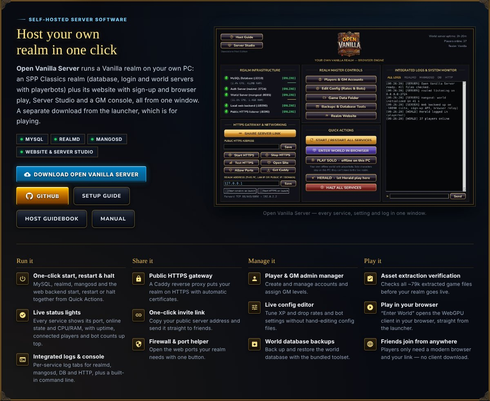
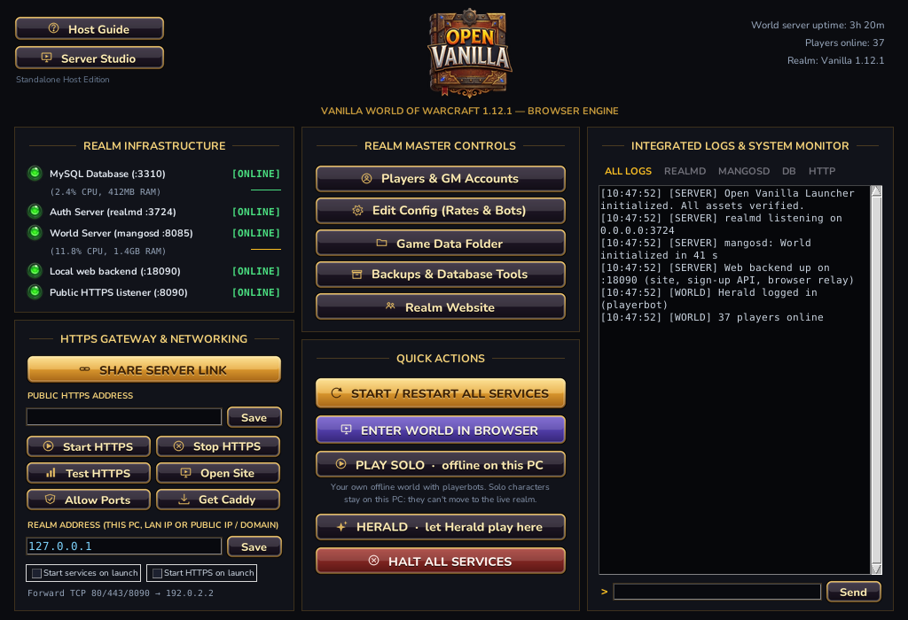

# Open Vanilla Server

**Everything that runs a Vanilla realm:** the one-window server for your own PC, the realm images and their patches, the web service with sign-up and browser play, Server Studio, Play Solo packs, the NAT relay, and the turnkey deployment behind [Vanilla Remastered](https://openvanilla.app/).

## Host a realm on your PC

**Open Vanilla Server** runs an [SPP Classics](https://github.com/celguar/spp-classics-cmangos) realm (database, login and world servers with playerbots) plus its website with sign-up and browser play, Server Studio and a GM console, all from one window. It finds your SPP install, sets the address players connect to, and has a **HERALD** button so Herald can play on your server too.

- Download: `OpenVanilla-Server.zip` on every [Open Vanilla release](https://github.com/orionopenwow/OpenVanilla/releases/latest), or run `Host a Realm.bat` here (Python 3.10+).
- Guide: [openvanilla.app/host.html](https://openvanilla.app/host.html).

## Run a public realm

| Part | Where |
|---|---|
| Realm images (web service + browser client, world server) | `realm/` (`realm/patches`, `realm/mangos`, built by `packaging/workflows/realm-image.yml`) |
| Vanilla Remastered gameplay (pace, Classic+ SQL and switches) | `realm/classicplus/` ([PACE.md](realm/classicplus/PACE.md)) |
| One-server deployment (Caddy, MariaDB, backups, Herald) | `hetzner/` ([README](hetzner/README.md)) |
| Relay for hosts behind NAT/CGNAT | `relay/` (Rust; [README](relay/README.md)) |
| Server Studio and the server window | `studio/`, `server_control.py`, `openvanilla_server.py` |
| Play Solo packs | `solo/` |

The world server is CMaNGOS (classic) with playerbots; the web service and browser client are [wenilla-realm](https://github.com/Arnesen/wenilla-realm) and [wenilla](https://github.com/Arnesen/wenilla) with Open Vanilla's patches.

## Part of Open Vanilla

[Open Vanilla](https://github.com/orionopenwow/OpenVanilla) is a free, open-source, community-built Vanilla project ([openvanilla.app](https://openvanilla.app/), [Discord](https://discord.gg/r6nj5p8U4)). Its products:

- [Vanilla Forge](https://github.com/orionopenwow/vanilla-forge): The Open Vanilla creator app: maps, models, creatures, quests, items and addons, tested in a copy of your game and published as a signed pack.
- [Vanilla Agents](https://github.com/orionopenwow/vanilla-agents): Your AI coding helpers as heroes in a cosy inn: you roam, they work, a checker verifies every quest.
- [Herald](https://github.com/orionopenwow/herald): The Open Vanilla Discord bot, the in-game World chat bridge, and Herald Autopilot: he plays a character for you, simulates gear and learns from play.
- [Open Vanilla Server](https://github.com/orionopenwow/openvanilla-server) (this one): Everything that runs a realm: the realm images and CMaNGOS patches, the web/asset service, Server Studio, Play Solo packs, the relay, and the turnkey Hetzner deployment.
- [Open Vanilla Launcher](https://github.com/orionopenwow/openvanilla-launcher): OpenVanilla.exe: play online, solo or in the browser, the Workshop, signed updates and live news; plus the release packaging.
- [Vanilla Remastered UI](https://github.com/orionopenwow/vanilla-remastered-ui): The in-game addon suite (WenillaCore, Quests, Transmog, Achievements, Guilds and the rest), Classic+ data, and the Workshop addon catalog.
- [openvanilla.app](https://github.com/orionopenwow/openvanilla-site): The Open Vanilla website (GitHub Pages) and the player manual.
- [Open Vanilla Devkit](https://github.com/orionopenwow/openvanilla-devkit): Test a change in seconds on your PC, try it against the live realm, and let a staging realm prove it first; plus the project's checks and tests.
- [Open Vanilla Agent Kit](https://github.com/orionopenwow/openvanilla-agent-kit): Let an AI coding agent change your copy of Open Vanilla for you: addons, interface, your own realm's rates and NPCs.
- [Open Vanilla Art & Tools](https://github.com/orionopenwow/openvanilla-art-tools): Art sources, UI kits and the generator scripts behind the launcher, site and addon artwork; plus the project's maintenance tools.

## License

MIT: see [LICENSE](LICENSE). The CMaNGOS patches in `realm/mangos/` and `solo/patches/` change CMaNGOS, which is GPL-2.0, so those patches are GPL-2.0 too. The patches in `realm/patches/` change wenilla and wenilla-realm (MIT / Apache-2.0) and are MIT like the rest.

## About this repository

This repository is published from **Open Vanilla** (commit `d1cfd7980d`: Release 1.31.0). Changes are made there and arrive here with each release, so please open issues and pull requests on [Open Vanilla](https://github.com/orionopenwow/OpenVanilla/issues).

World of Warcraft is a trademark of Blizzard Entertainment, Inc. Open Vanilla is an independent fan project, not affiliated with or endorsed by Blizzard Entertainment. No Blizzard game files are included: you need your own.
